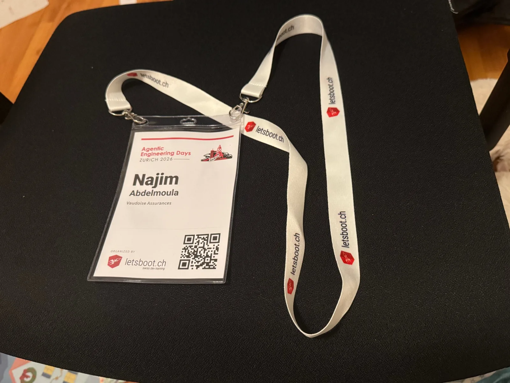
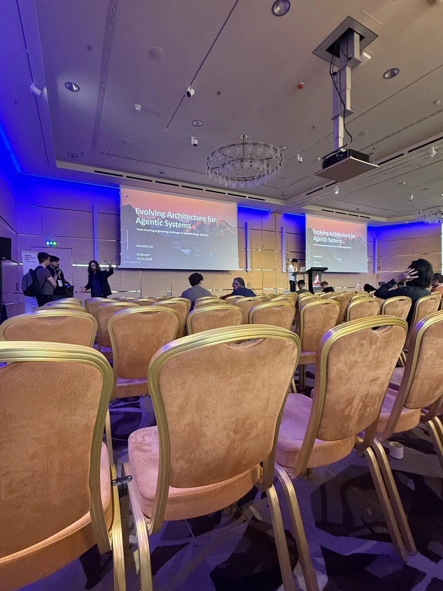

On 20 November 2026 I spent the day at the [Agentic Engineering Days](https://www.agenticdays.com/) in Zurich, held at the Marriott and organised by [letsboot.ch](https://www.letsboot.ch/). The programme was packed with 25-minute talks on building software with, and for, AI agents. I attended nine of them, spread over four rooms, and this post walks through the day in order.

<figure>
  
  <figcaption>My badge for the day.</figcaption>
</figure>

I went for two reasons. It was a good opportunity to see how agentic architecture patterns are actually put in place inside companies, and a way to build up my skills on the broader questions around AI agents.

Each section gives the session's time and room, the speaker, a summary of what the session set out to cover (based on the official abstract), and links to the speaker and to related material. None of the session pages listed slides or recordings when I wrote this, so I link to the session pages themselves.

## The day at a glance

| Time | Room | Session | Speaker(s) |
|------|------|---------|-----------|
| 09:20 | Studio 3 AB | [Migration or migraine: what no one tells you about using LLMs](https://www.agenticdays.com/session/1241628-migration-or-migraine-what-no-one-tells-you-about-using-llms) | Warren Parad, Authress |
| 10:20 | Millennium | [Beyond prompts & models: evolving architecture for agentic systems](https://www.agenticdays.com/session/1292484-beyond-prompts-models-evolving-architecture-for-agentic) | Manisha De, Swisscom |
| 11:00 | Studio 4 | [Building authorization for agentic RAG systems](https://www.agenticdays.com/session/1286299-building-authorization-for-agentic-rag-systems) | Sohan Maheshwar, AuthZed |
| 11:40 | Studio 4 | [Specs first, code later](https://www.agenticdays.com/session/1322247-specs-first-code-later-or-how-i-build-software-in-the-ai) | Alessandra Pasini, AWS |
| 13:00 | Studio 6 | [We rolled out GitHub Copilot… how do we prove it helps?](https://www.agenticdays.com/session/1290786-we-rolled-out-github-copilot-how-do-we-prove-it-helps) | Yuliya Khadasevich, Eneco, and Liuba Gonta, Xebia |
| 13:40 | Studio 6 | [Agents need platforms too](https://www.agenticdays.com/session/1243798-agents-need-platforms-too-running-llm-and-agent-workloads) | Aarno Aukia, VSHN |
| 14:20 | Millennium | [When software stops being deterministic](https://www.agenticdays.com/session/1287383-when-software-stops-being-deterministic-rethinking) | Susanna Wong, Typeform |
| 15:20 | Studio 6 | [FSI transformation at scale: sovereignty, compliance & production realities](https://www.agenticdays.com/session/1309668-fsi-transformation-at-scale-sovereignty-compliance) | Sergiu Petean, Atlassian, and Baris Yorganci, BarmeniaGothaer |
| 16:00 | Millennium | [Human-in-the-loop is you](https://www.agenticdays.com/session/1282535-human-in-the-loop-is-you-a-guide-to-working-with-multiple) | Oleksandra Bovkun, Databricks |

## 1. Migration or migraine: what no one tells you about using LLMs

**09:20, Studio 3 AB.** [Warren Parad](https://linkedin.com/in/warren-parad), CTO and security specialist at [Authress](https://authress.io) and AWS Community Builder.

The day opened with a very concrete use case: a one-off migration of about 100 components in a managed authentication system that runs in production. Each framework had to be upgraded to its latest version without lowering test coverage and without breaking anything for customers. Warren shared how an LLM-assisted approach to this deceptively simple but surprisingly hard job played out: what matched the team's expectations, what surprised them, and what it meant for developer experience, efficiency and quality. He also addressed what both AI skeptics and AI optimists tend to get wrong. The abstract stresses that the talk is not tied to any particular model or technology, and files it under lessons learned and anti-patterns as well as spec-driven and agentic software development.

More from Warren: his articles on [dev.to](https://dev.to/wparad).

<!-- TODO (Najim): your takeaway from this talk. -->

## 2. Beyond prompts & models: evolving architecture for agentic systems

**10:20, Millennium.** [Manisha De](https://www.linkedin.com/in/manisha-de-58616483/), Product Owner at [Swisscom](https://www.swisscom.ch).

Manisha presented an architectural evolution model built in hindsight from the recurring decisions and trade-offs her team met while prototyping and growing enterprise agentic systems. The model groups them into stages, so a team can see where its architecture stands and which engineering problems usually come next. The path she traced through Swisscom's work on knowledge management, product management and AI-assisted operations ran through: data readiness as the foundation for context engineering; quick prototyping of workflows in n8n; a rebuild of multi-agent systems on the Strands Agents SDK under enterprise constraints; a move from early vector-based RAG to a leaner "vectorless" approach; standardising agent capabilities with MCP; and finally re-implementing the same workflows with Kiro, GitHub Copilot and reusable agent skills to trade custom orchestration for a smaller footprint. Her argument is that orchestration, context engineering, interoperability and simplicity decide the success of these systems more than raw model capability.

<figure>
  
  <figcaption>Manisha De's session (Swisscom), with the opening slide on the screens.</figcaption>
</figure>

<!-- TODO (Najim): your takeaway from this talk. -->

## 3. Building authorization for agentic RAG systems

**11:00, Studio 4.** [Sohan Maheshwar](https://linkedin.com/in/sohanmaheshwar/), Developer Advocate Lead at [AuthZed](https://www.authzed.com) and AAIF Ambassador.

Before enterprises can roll out agentic RAG widely, they need to guarantee that an agent only retrieves data the person asking is allowed to see. Sohan's talk went into fine-grained authorization to get there. He covered Google's Zanzibar model and its relationship-based access control (ReBAC), how such a system works internally, and how to apply it to agentic RAG with pre-filtering and post-filtering of results. He also briefly looked at how OpenAI handles authorization at scale for ChatGPT Apps. The session included a live coding demo with open-source tools: Weaviate, LangChain and SpiceDB.

Related reading: AuthZed's tutorial [Building Agentic RAG with SpiceDB, LangChain & Weaviate](https://authzed.com/docs/spicedb/tutorials/agentic-rag), and Sohan's [blog](http://sohan.co).

<!-- TODO (Najim): your takeaway from this talk. -->

## 4. Specs first, code later (or how I build software in the AI-DLC era)

**11:40, Studio 4 (Spotlight talk).** [Alessandra Pasini](https://www.linkedin.com/in/alessandrapasini/), Solutions Architect at AWS.

Alessandra's starting point is to write a structured specification before any code is generated: what the system must do, how it behaves at the edges, and what "done" means. She presented AI-DLC, a lifecycle in three phases. In inception the AI proposes the architecture, in construction it generates and iterates on code from the spec, and in operations it monitors and patches. Humans steer at each gate between phases. The talk followed a real project built this way, showed where a good spec caught bugs that tests had missed, and showed when rewriting the spec is quicker than fixing the code. Attendees were promised practical rules for writing specs and a workflow to try on their next feature.

Related reading: the AWS DevOps blog post [AI-Driven Development Life Cycle](https://aws.amazon.com/blogs/devops/ai-driven-development-life-cycle) and the open-source [aidlc-workflows](https://github.com/awslabs/aidlc-workflows) repository on GitHub.

<!-- TODO (Najim): your takeaway from this talk. -->

## 5. We rolled out GitHub Copilot… how do we prove it helps?

**13:00, Studio 6.** [Yuliya Khadasevich](https://www.linkedin.com/in/yulkhadas/), Engineering Manager and Microsoft MVP at Eneco, and [Liuba Gonta](https://www.linkedin.com/in/liuba-gonta), IT consultant, GitHub trainer and Microsoft MCT at [Xebia](https://xebia.com).

Leaders who have rolled out an AI coding assistant eventually ask whether it actually helps. Yuliya and Liuba framed this as a familiar measurement problem, comparable to earlier shifts such as Agile, DevOps and CI/CD. They covered how to reason about the impact of GenAI assistants across the whole software development life cycle using existing frameworks such as DORA and SPACE, and how Copilot's own tool-level metrics can add context. Their position is that generated lines of code are the wrong yardstick, and that Copilot metrics are most useful for understanding adoption and improving enablement, provided they are interpreted correctly. The talk targets architects, engineering leaders and senior developers.

<!-- TODO (Najim): your takeaway from this talk. -->

## 6. Agents need platforms too: running LLM and agent workloads the cloud-native way

**13:40, Studio 6.** [Aarno Aukia](https://linkedin.com/in/aukia), Co-Founder and Partner at [VSHN](https://vshn.ch).

Once agents leave a laptop for production, a different set of questions appears: where do they run, how are they observed, how do they reach tools and secrets, how is cost kept in check, and how do you recover from failures? Aarno mapped the building blocks of an agent platform: Kubernetes-based inference with open models, API gateways, tool access, observability, safety boundaries and lifecycle operations. The session lists Kubernetes, vLLM, LiteLLM, Kubeflow and OpenShift among its technologies. The stated aim is to show what it takes to run agents like real software, without the hype.

More from Aarno: his [slides on SlideShare](https://de.slideshare.net/AarnoAukia/presentations).

<!-- TODO (Najim): your takeaway from this talk. -->

## 7. When software stops being deterministic

**14:20, Millennium.** [Susanna Wong](https://www.linkedin.com/in/susanna-wong-london/), Staff Engineer and Google Developer Expert at Typeform.

Classic software engineering assumes that the same input gives the same output, so a change in behaviour can be traced back to a change in code. LLM systems break that assumption: behaviour emerges from prompts, retrieval, context, model choice and evaluation, a feature can regress while no business logic changes, and a prompt fix can introduce a new failure. Drawing on features being built at Typeform, including trade-offs, dead ends and unsolved problems, Susanna covered four practices: continuous evaluation rather than relying only on traditional test suites; trace-level observability rather than application logs alone; reviewing prompts and other AI artefacts as first-class engineering assets; and orchestrating systems that contain inherently non-deterministic parts. The talk is aimed at people already building LLM applications or about to start.

<!-- TODO (Najim): your takeaway from this talk. -->

## 8. FSI transformation at scale: sovereignty, compliance & production realities

**15:20, Studio 6 (Spotlight talk, sponsored by Atlassian).** [Sergiu Petean](https://www.linkedin.com/in/peteanusergiu/), EMEA Field CTO at Atlassian, and [Baris Yorganci](https://www.linkedin.com/in/baris-yorganci-497a89296/), Head of Division at BarmeniaGothaer.

This one was a fireside chat rather than a classic talk. The question: can financial institutions realistically become "AI-native" given data sovereignty requirements, evolving compliance rules and complex production environments? The two speakers drew on lessons from neo-banks, digital insurers and MGAs, and discussed how sovereignty, compliance and production constraints can be turned into structural guardrails for AI innovation instead of obstacles.

<!-- TODO (Najim): your takeaway from this talk. -->

## 9. Human-in-the-loop is you: working with multiple coding agents

**16:00, Millennium.** [Oleksandra Bovkun](https://www.linkedin.com/in/oleksandra-bovkun/), Developer Advocate at [Databricks](https://www.databricks.com/).

The last session of the day started from a very practical annoyance. "Human in the loop" is supposed to mean a person making judgement calls, but with several coding agents open at once it often means pasting the same bug report into different chat windows, re-explaining context, and losing track of which agent tried which fix. Oleksandra asked whether a meta-harness could help by combining several agents into one workflow, by replacing constant manual supervision with spend caps and approval policies, and by sharing a live session so a teammate can review or co-drive. The session announces Claude Code, Codex and Omnigent as the main tools, a live demo, lessons learned and a verdict on whether the approach holds up.

**About Omnigent.** Omnigent is an open-source meta-harness from Databricks, currently in alpha. A harness is the layer a tool such as Claude Code or Codex wraps around a model. Omnigent sits one level above and puts several of them (Claude Code, Codex, Cursor, Pi, or custom agents defined in YAML) behind a common interface, so you can swap them or mix them in one session, for instance by having one agent review another's work. Its controls are enforced at that layer rather than through prompts: cost policies track each session's spend and can pause the agent for confirmation, approval policies make it stop before risky actions (for example, a human must approve a `git push` after a package download), and a sandbox keeps credentials such as a GitHub token out of the agent's reach. For sharing, a live session can be opened to teammates by URL so they can follow the agent, comment on files and send commands, and the same session is reachable from the web, mobile or an API. This summary comes from the project's public documentation, not from the talk itself.

Related reading: Databricks' announcement [Introducing Omnigent](https://www.databricks.com/blog/introducing-omnigent-meta-harness-combine-control-and-share-your-agents) and the [omnigent repository](https://github.com/omnigent-ai/omnigent) on GitHub.

<!-- TODO (Najim): your takeaway from this talk. -->

## Threads running through the day

A few themes came back from one session to the next, and a handful of talks stayed with me more than the others.

- **Evolving an architecture, not just building one.** Manisha's talk was one of the two that impressed me most. It was a high-quality walk through how an architecture changed once the problems of a multi-agent setup appeared, and it ends with a smaller footprint rather than a bigger one. Aarno's platform talk meets it from the other side by treating agents like ordinary software to run.
- **Security as a design input.** Sohan's session on authorization was the other one I liked most. The model inspired by Google's Zanzibar is very simple, and he presented it extremely well. The FSI fireside chat on sovereignty and compliance sits in the same family.
- **Specification before code.** Alessandra's talk was good quality, even though it was very much centred on the Amazon stack. Warren's migration talk lists spec-driven development among its topics too, and it was the most useful field report of the day: the one I would like as many people as possible to be able to access.
- **Non-determinism needs new habits.** Susanna's practices (continuous evaluation, trace-level observability, prompts under review) and the Copilot measurement talk both ask how to know whether AI-assisted work is actually better.
- **People stay in the loop.** Oleksandra's closing talk gave me real leads to explore professionally, on how a human supervises several harnesses without becoming the bottleneck.

### Questions that remain

I understand why adopting AI matters to stay ahead. Still, a few questions stay open for me, and they are more philosophical than technical: return on investment, and governance.

### What I take away

I will keep following the field and keep collecting real-world feedback. I want to bring agentic AI into scenarios where it truly adds value, without putting all my eggs in one basket. Above all, I want to keep a full grasp of how it works and of what it produces.

## Links

- Event: [Agentic Engineering Days](https://www.agenticdays.com/) and its [LinkedIn page](https://www.linkedin.com/company/agentic-days/)
- Organiser: [letsboot.ch](https://www.letsboot.ch/)

## Thank you

First of all, a big thank you to my employer, [Vaudoise Assurances](https://www.vaudoise.ch/), for giving me the opportunity to take part in this conference. Thank you as well to the team at [letsboot.ch](https://www.letsboot.ch/) for organising the day, and to all the speakers for sharing their experience and their lessons learned. And thank you for reading this far. If you were there too, or if you have your own take on any of these topics, I would love to hear it in the comments below.
